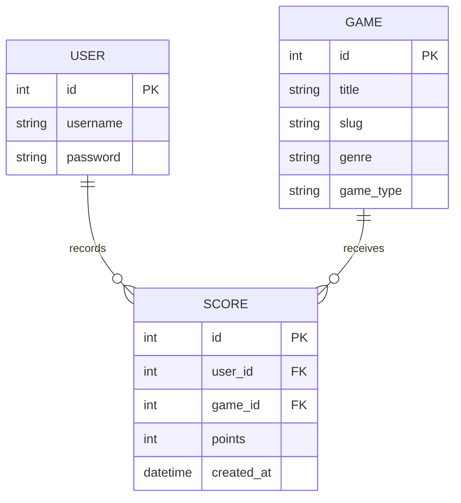

# NEON ARCADE — Django Gaming Platform

## 1. Abstract
Neon Arcade is a web-based gaming platform developed using Python and Django. It provides a central library where users can discover games, play browser-based games, register an account, save scores and view leaderboard rankings. The interface uses a responsive dark blue and purple neon theme. SQLite stores game records and player scores.

## 2. Problem statement
Players often need to visit different websites to discover small browser games and track their performance. This project demonstrates a single web application for browsing a game catalog, playing simple games and maintaining score records.

## 3. Objectives
- Develop a responsive gaming website using Django.
- Provide search and filters for the game library.
- Implement browser games using JavaScript.
- Add registration, login and logout.
- Save authenticated users' scores.
- Display player profiles and a leaderboard.
- Provide an admin interface for managing game listings.
- Test the major user workflows.

## 4. Technology stack
- Front end: HTML5, CSS3, JavaScript
- Back end: Python, Django
- Database: SQLite (default development database)
- Authentication: Django built-in authentication
- Development tools: VS Code, Python, Django admin

## 5. Modules
1. **Home:** featured and recently added games.
2. **Game library:** search by title, filter by genre and format.
3. **Game details:** game description, play/download action and top scores.
4. **Browser games:** Neon Snake, Memory Match and Click Rush.
5. **User authentication:** registration, login and logout.
6. **Player profile:** recent saved scores.
7. **Leaderboard:** highest recorded scores grouped by player and game.
8. **Admin management:** create, edit and delete game listings and review score records.

## 6. Database design
### Game
- `id` — primary key
- `title` — game title
- `slug` — unique URL identifier
- `description` — description
- `genre` — category
- `game_type` — browser or download
- `cover` — optional cover image
- `download_url` — optional authorized external link
- `featured` — whether to show as featured
- `created_at` — record creation time

### Score
- `id` — primary key
- `user_id` — foreign key to Django user
- `game_id` — foreign key to Game
- `points` — saved score
- `created_at` — time score was saved

### Relationship
One user can have many scores. One game can have many scores. Each score belongs to one user and one game.

## 7. Main workflow
1. A visitor opens the home page.
2. The visitor explores or searches the game library.
3. The visitor opens a game detail page and launches a browser game.
4. The visitor registers or logs in to save a completed score.
5. The application stores the score in SQLite.
6. The user can review saved scores on their profile and compare results on the leaderboard.
7. An administrator manages game listings through Django admin.

## 8. Testing plan
| Test | Expected result |
|---|---|
| Open home page | Featured and recent games render |
| Search game title | Matching game records appear |
| Filter by genre/type | Only matching records appear |
| Register valid account | Account is created and user is logged in |
| Login with valid credentials | User reaches profile |
| Play Snake | Snake moves and game-over is shown after collision |
| Play Memory Match | Matching pairs are detected |
| Play Click Rush | Click counter runs during the timed challenge |
| Save score while logged in | Score is saved and confirmation appears |
| Open profile | User's saved scores are displayed |
| Open leaderboard | Best saved scores are ranked |
| Add game in admin | Game appears in the library |

## 9. Limitations and future enhancements
- Browser scores are submitted from client-side JavaScript and are not cheat-proof.
- The included browser games are simple demonstrations.
- Downloadable game files should only be hosted or linked with distribution permission.
- Future work can include more games, avatars, achievements, pagination, stronger score validation, automated tests, and deployment to a production host.

## 10. Conclusion
Neon Arcade demonstrates a complete beginner-to-intermediate Django application integrating database models, authentication, templates, static assets, browser-side JavaScript, administration and score reporting. It can be extended into a larger gaming portal after production security and validation improvements.
